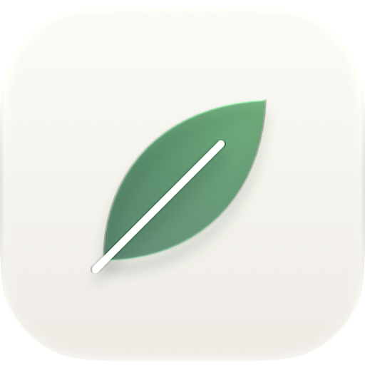

<p align="center">
  
</p>

<h1 align="center">Leaf</h1>

<p align="center">
  Double-cliquez pour lire. Fermez pour partir.<br>
  Une liseuse légère et native pour Mac. Gratuite et open source.
</p>

<p align="center">
  <a href="https://github.com/chengffei/leaf/releases/latest/download/Leaf.dmg"><b>Télécharger</b></a> ·
  <a href="https://chengffei.github.io/leaf/">Site web</a>
</p>

<p align="center">
  <a href="README.md">English</a> ·
  <a href="README.zh-Hans.md">简体中文</a> ·
  <a href="README.zh-Hant.md">繁體中文</a> ·
  <a href="README.ja.md">日本語</a> ·
  <a href="README.ko.md">한국어</a> ·
  <b>Français</b> ·
  <a href="README.de.md">Deutsch</a> ·
  <a href="README.es.md">Español</a>
</p>

<p align="center">
  
</p>

## Pourquoi Leaf

Un livre, une fenêtre. Double-cliquez sur un livre dans le Finder et commencez à lire. Fermez la fenêtre, et Leaf se ferme aussi.

- **Pas de bibliothèque.** Rien à importer, aucune copie, aucun compte.
- **Reprenez là où vous en étiez.** Même si vous renommez ou déplacez le fichier.
- **Pensée pour le Mac.** Menus natifs, raccourcis, Rechercher et Traduire. Environ 5 Mo.

## Conçue pour la lecture

- **Six formats.** EPUB, MOBI, AZW3, PDF, FB2 et CBZ s’ouvrent tels quels, sans conversion. Les MOBI et AZW3 doivent être sans DRM. Les PDF gardent leur mise en page d’origine.
- **Le texte à votre goût.** N’importe quelle police, avec Literata intégrée. Taille de 80 à 200 %, cinq graisses, et des réglages pour l’interligne, l’espace entre paragraphes, l’espacement des lettres, les marges et l’alignement.
- **Préréglages.** Compact, Standard, Grand, Basse vision et Encre électronique. Vous pouvez aussi enregistrer les vôtres.
- **Thèmes.** Papier, Sépia, Encre électronique et Sombre, ou celui du système.
- **Temps restant.** Cliquez dans le coin inférieur droit pour afficher le pourcentage, l’emplacement, ou le temps restant dans le chapitre ou le livre, calculé d’après votre vitesse de lecture.
- **Notes sur place.** Cliquez sur un appel de note pour l’afficher à l’endroit même. Après un saut, `⌘[` vous ramène en arrière.
- **Rechercher et atteindre.** `⌘F` liste les résultats par chapitre. `⌘L` vous emmène à n’importe quel pourcentage ou emplacement.
- **Table des matières flottante.** `⌘T` l’ouvre par-dessus la page, sans recomposer le texte.
- **Mise en page.** Réglez la largeur du texte, lisez sur une ou deux colonnes, et cliquez sur les bords de la page pour la tourner.
- **Images.** Double-cliquez sur une image pour la voir en taille réelle.
- **Surlignages et notes.** Sélectionnez du texte, choisissez une des quatre couleurs et ajoutez une note. `⌘D` pose un signet sur la page. Le panneau Notes (`⇧⌘N`) liste tout par chapitre.
- **Export.** En Markdown, ou au format My Clippings de Kindle pour Readwise et Obsidian.
- **Recherche d’un mot en une étape.** Sélectionnez un mot et appuyez sur `⌃⌘D`, ou utilisez la barre qui apparaît au-dessus de la sélection.
- **À propos du livre.** La description tirée des métadonnées du livre, en tête du panneau.
- **Texte vertical.** Les livres japonais composés verticalement s’ouvrent ainsi, page suivante à gauche. Réglages › Mise en page › Sens d’écriture force le vertical ou l’horizontal pour n’importe quel livre.
- **Huit langues.** Anglais, chinois simplifié, chinois traditionnel, japonais, coréen, français, allemand et espagnol.

## Comparaison

[Readest](https://github.com/readest/readest) en fait le plus. Apple Books est fourni avec votre Mac. Calibre est le meilleur pour gérer une collection. Leaf se contente d’ouvrir un livre. Voir la [comparaison complète](https://chengffei.github.io/leaf/#compare).

## À venir

- Vos réglages de police avant ceux de l’éditeur, et les fichiers TXT
- Les vrais numéros de page, et un retour après avoir feuilleté plus loin
- Vignettes dans le Finder, Coup d’œil et recherche Spotlight, plus tard

Pas prévu : bibliothèque, boutique, compte ou synchronisation.

## Installation

1. Téléchargez [Leaf.dmg](https://github.com/chengffei/leaf/releases/latest/download/Leaf.dmg) et faites glisser Leaf dans Applications.
2. Leaf n’est pas notarisée par Apple, donc macOS la bloque la première fois. Ouvrez-la et cliquez sur **Terminé**. Allez ensuite dans **Réglages Système › Confidentialité et sécurité**, faites défiler vers le bas et cliquez sur **Ouvrir quand même**.

Nécessite macOS 15 ou une version ultérieure.

## Raccourcis

| Action | Touches |
|---|---|
| Tourner la page | `←` `→`, Espace, ou balayage sur le trackpad |
| Table des matières | `⌘T` ou `T`, ou clic sur le nom du chapitre en bas à gauche |
| Taille du texte | `⌘=` plus grand, `⌘-` plus petit, `⌘0` taille réelle |
| Rechercher | `⌘F`, puis `⌘G` suivant et `⇧⌘G` précédent |
| Atteindre | `⌘L` |
| Taille et thème | `Aa` en haut à droite, ou clic droit sur la page |
| Réglages | `⌘,` |
| Surligner | Sélectionner du texte, puis une couleur |
| Signet | `⌘D` |
| Notes | `⇧⌘N` |
| Rechercher | `⌃⌘D` |

## Compiler depuis les sources

Nécessite Xcode 26 et [XcodeGen](https://github.com/yonaskolb/XcodeGen).

```sh
xcodegen generate
./scripts/install.sh      # compiler et installer dans /Applications
./scripts/make-dmg.sh     # créer un DMG dans ~/Downloads
```

Les notes d’architecture et les pièges connus sont dans [DEVELOPMENT.md](DEVELOPMENT.md) (en chinois).

## Crédits

Rendu et analyse des formats par [foliate-js](https://github.com/johnfactotum/foliate-js) (MIT). Les livres d’exemple de `TestBooks/` proviennent du [Projet Gutenberg](https://www.gutenberg.org/) et sont dans le domaine public.

## Contribuer

Les contributions sont les bienvenues. Pour contribuer du code, vous devez accepter le [contrat de licence des contributeurs](CLA.md).

## Licence

[GPL-3.0](LICENSE). foliate-js conserve sa licence MIT dans `Web/foliate/LICENSE`.
