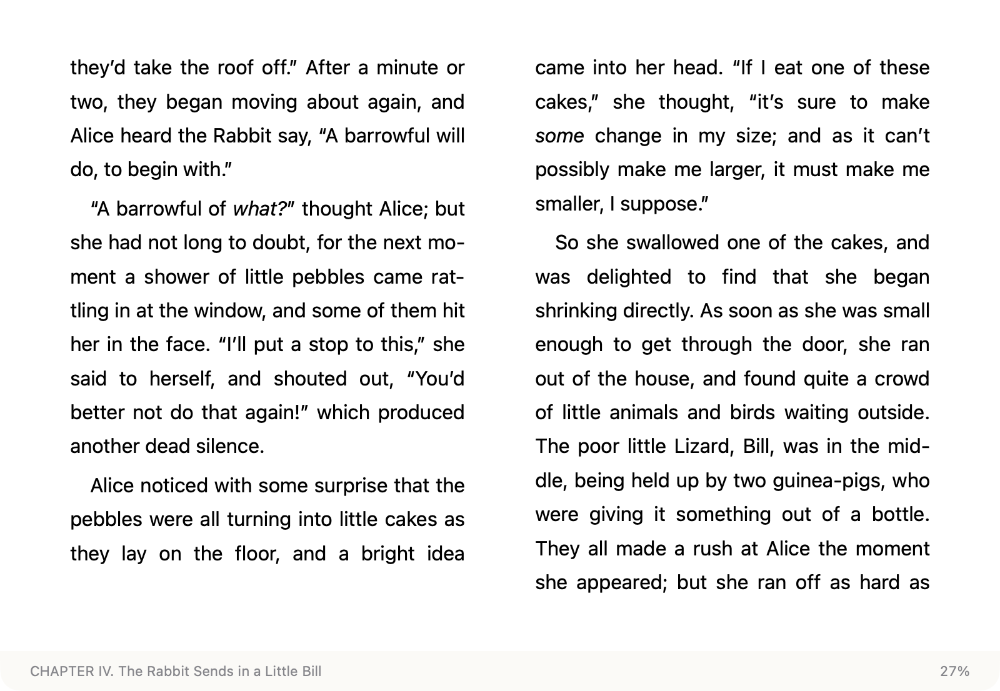

<p align="center">
  
</p>

<h1 align="center">Leaf</h1>

<p align="center">
  ダブルクリックで読む。閉じたら終わり。<br>
  小さくてネイティブな Mac 用電子書籍リーダー。無料でオープンソース。
</p>

<p align="center">
  <a href="https://github.com/chengffei/leaf/releases/latest/download/Leaf.dmg"><b>ダウンロード</b></a> ·
  <a href="https://chengffei.github.io/leaf/">Web サイト</a>
</p>

<p align="center">
  <a href="README.md">English</a> ·
  <a href="README.zh-Hans.md">简体中文</a> ·
  <a href="README.zh-Hant.md">繁體中文</a> ·
  <b>日本語</b> ·
  <a href="README.ko.md">한국어</a> ·
  <a href="README.fr.md">Français</a> ·
  <a href="README.de.md">Deutsch</a> ·
  <a href="README.es.md">Español</a>
</p>

<p align="center">
  
</p>

## Leaf について

1 冊に 1 つのウインドウ。Finder で本をダブルクリックすれば、すぐに読めます。ウインドウを閉じると Leaf は終了します。

- **ライブラリなし。** 読み込みもコピーも、アカウントも不要です。
- **続きから読める。** ファイル名を変えても、場所を移しても大丈夫です。
- **Mac になじむ。** 標準のメニュー、ショートカット、調べる、翻訳に対応。約 5 MB です。

## 読むためのデザイン

- **6 つのフォーマット。** EPUB、MOBI、AZW3、PDF、FB2、CBZ を変換なしで開けます。MOBI と AZW3 は DRM なしのものに限ります。PDF は元のレイアウトのまま表示します。
- **文字は好みに。** 好きなフォントを使えて、Literata も内蔵。文字サイズは 80〜200%、太さは 5 段階。行間、段落の間隔、字間、余白、揃え方も調整できます。
- **プリセット。** コンパクト、標準、大きな文字、ロービジョン、電子ペーパー。自分のプリセットも保存できます。
- **テーマ。** ペーパー、セピア、電子ペーパー、ダーク、またはシステムに合わせる。
- **残り時間。** 右下をクリックすると、パーセント、位置、章と本の残り時間を切り替えられます。残り時間は読む速さから見積もります。
- **その場で脚注。** 番号をクリックすると、注がその場に表示されます。ジャンプした後は `⌘[` で戻れます。
- **検索と移動。** `⌘F` で結果を章ごとに一覧表示。`⌘L` で任意のパーセントや位置へ移動します。
- **浮かぶ目次。** `⌘T` で本文の上に表示するので、本文が組み直されません。
- **レイアウト。** 本文の幅、1 段か 2 段かを選べます。ページの端をクリックするとページをめくれます。
- **画像。** ダブルクリックで原寸表示。
- **8 つの言語。** 英語、簡体字中国語、繁体字中国語、日本語、韓国語、フランス語、ドイツ語、スペイン語。

## ほかのアプリとの比較

[Readest](https://github.com/readest/readest) は機能がいちばん豊富です。Apple Books は Mac に最初から入っています。Calibre は蔵書の管理が得意です。Leaf は本を開くことだけに集中しています。詳しくは[比較表](https://chengffei.github.io/leaf/#compare)をご覧ください。

## 今後の予定

- ハイライト、ブックマーク、Markdown または Kindle の My Clippings への書き出し
- ワンステップで単語を調べる
- 出版社のスタイルより自分のフォント設定を優先、TXT に対応
- Finder のサムネール、クイックルック、Spotlight 検索はその後

予定していないもの：ライブラリ、ストア、アカウント、同期。

## インストール

1. [Leaf.dmg](https://github.com/chengffei/leaf/releases/latest/download/Leaf.dmg) をダウンロードし、Leaf を「アプリケーション」にドラッグします。
2. Leaf は Apple の公証を受けていないため、初回は macOS にブロックされます。一度開いて「完了」をクリックし、「システム設定 › プライバシーとセキュリティ」を下までスクロールして「このまま開く」をクリックしてください。

macOS 15 以降が必要です。

## ショートカット

| 操作 | キー |
|---|---|
| ページをめくる | `←` `→`、スペース、またはトラックパッドで左右にスワイプ |
| 目次 | `⌘T` または `T`、または左下の章名をクリック |
| 文字サイズ | `⌘=` 大きく、`⌘-` 小さく、`⌘0` 実際のサイズ |
| 検索 | `⌘F`、`⌘G` 次へ、`⇧⌘G` 前へ |
| 移動 | `⌘L` |
| 文字サイズとテーマ | 右上の `Aa`、またはページを右クリック |
| 設定 | `⌘,` |

## ソースからビルド

Xcode 26 と [XcodeGen](https://github.com/yonaskolb/XcodeGen) が必要です。

```sh
xcodegen generate
./scripts/install.sh      # ビルドして /Applications にインストール
./scripts/make-dmg.sh     # ~/Downloads に DMG を作成
```

設計と既知の落とし穴は [DEVELOPMENT.md](DEVELOPMENT.md)（中国語）にまとめています。

## クレジット

描画とフォーマット解析は [foliate-js](https://github.com/johnfactotum/foliate-js)（MIT）によるものです。`TestBooks/` のサンプル本は [Project Gutenberg](https://www.gutenberg.org/) のパブリックドメイン作品です。

## コントリビュート

コントリビュートを歓迎します。コードを送るには[コントリビューター・ライセンス契約](CLA.md)への同意が必要です。

## ライセンス

[GPL-3.0](LICENSE)。foliate-js は MIT ライセンスのままです（`Web/foliate/LICENSE`）。
