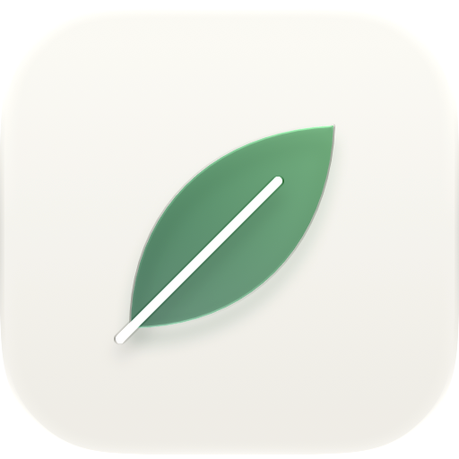
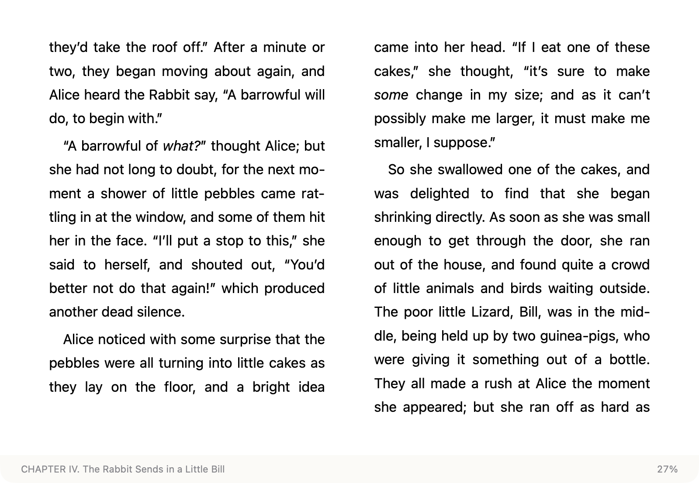

<p align="center">
  
</p>

<h1 align="center">Leaf</h1>

<p align="center">
  Double-click to read. Close to leave.<br>
  双击就读，关窗就走。<br><br>
  An open-source EPUB, MOBI and AZW3 reader for Mac that reads like a Kindle.<br>
  开源的 Mac 电子书阅读器，读起来像 Kindle。
</p>

<p align="center">
  <a href="https://github.com/chengffei/leaf/releases/latest/download/Leaf.dmg"><b>Download</b></a> ·
  <a href="https://chengffei.github.io/leaf/">Website</a> ·
  <a href="#中文">中文</a>
</p>

<p align="center">
  
</p>

## Why Leaf

One book, one window. Double-click a book in Finder to read it; close the window and Leaf quits.

- **No library:** no import, no copies, no account
- **Remembers your place:** even after you rename or move the file
- **Native, 2.7 MB:** real Mac menus, shortcuts, Look Up and Translate

Leaf is an independent project and is not affiliated with Amazon. Kindle is a trademark of Amazon.com, Inc.

## Reads like a Kindle

- **Time left:** click the bottom-right corner to cycle percent, location, time left in chapter and in book, estimated from how fast you read
- **Your type:** any font, size 80–200%, five weights, line / paragraph / letter spacing, margins, alignment
- **Presets:** Compact, Standard, Large, Low Vision, plus your own
- **Footnotes in place:** click a marker and the note pops up; **Back** or `⌘[` returns from any jump
- **Find and go to:** `⌘F` lists results by chapter; `⌘L` jumps to a percent or location
- **Floating contents:** `⌘T`; it floats over the page, so nothing reflows
- **Layout:** text width, one or two columns, click the page edges to turn
- **Three formats:** EPUB, MOBI and AZW3, no conversion (MOBI/AZW3 must be DRM-free)
- **Images:** double-click to view full size
- **Themes:** paper, sepia, dark or system
- **Eight languages:** English, 简体中文, 繁體中文, 日本語, 한국어, Français, Deutsch, Español

## How it compares

[Readest](https://github.com/readest/readest) does the most. Apple Books comes with your Mac. Calibre manages collections best. Leaf does one thing: open a book. See the [full table](https://chengffei.github.io/leaf/#compare).

## Roadmap

Highlights and notes, bookmarks, export, one-step dictionary lookup and a vocabulary list are next. Not planned: PDF, a store, an account, sync.

## Install

1. Download [Leaf.dmg](https://github.com/chengffei/leaf/releases/latest/download/Leaf.dmg) and drag Leaf into Applications.
2. **First launch:** Leaf is not notarized by Apple, so macOS blocks it once. Open it and dismiss the warning, then go to *System Settings › Privacy & Security*, scroll down and click **Open Anyway**.

Requires macOS 15 or later.

## Shortcuts

| Action | Keys |
|---|---|
| Turn page | `←` `→` · Space · swipe left/right on the trackpad |
| Contents | `⌘T`, `t`, or click the chapter name bottom-left |
| Font size | `⌘=` larger · `⌘-` smaller · `⌘0` actual size |
| Find | `⌘F` · `⌘G` next · `⇧⌘G` previous |
| Go to | `⌘L` |
| Size and theme | `Aa` in the top-right corner, or right-click the page |
| All settings | `⌘,` |

## Build from source

Requires Xcode 26 and [XcodeGen](https://github.com/yonaskolb/XcodeGen):

```sh
xcodegen generate
./scripts/install.sh      # build and install to /Applications
./scripts/make-dmg.sh     # package a DMG into ~/Downloads
```

Architecture notes and known pitfalls are in [DEVELOPMENT.md](DEVELOPMENT.md) (Chinese).

## Credits

Rendering and format parsing by [foliate-js](https://github.com/johnfactotum/foliate-js) (MIT). Sample books in `TestBooks/` are from [Project Gutenberg](https://www.gutenberg.org/) and in the public domain.

## License

[MIT](LICENSE)

---

## 中文

### 为什么做 Leaf

一本书，一个窗口。在访达里双击就读，关掉窗口，Leaf 就退出。

- **没有书库**：不导入，不复制文件，不要账号
- **记得读到哪**：改名、挪位置，也能接着读
- **原生，2.7 MB**：系统菜单、快捷键、查询与翻译，都是 Mac 原装

Leaf 是独立项目，与 Amazon 无关。Kindle 是 Amazon.com, Inc. 的商标。

### 读起来像 Kindle

- **还要读多久**：点右下角循环百分比、位置、本章剩余、全书剩余，按你的阅读速度估算
- **排版随你调**：任意字体，字号 80%–200%，字重五级，行距、段距、字距，页边距，对齐方式
- **排版预设**：紧凑、标准、大字、低视力，也能存自己的
- **脚注就地弹出**：点编号即弹出注释；跳转后按「返回」或 `⌘[` 回原处
- **查找与跳转**：`⌘F` 按章节列出结果；`⌘L` 跳到百分比或位置号
- **浮动目录**：`⌘T` 打开，浮在页面上，书页不动
- **版式**：版心宽度，单栏或双栏，点页面两侧翻页
- **三种格式**：EPUB、MOBI、AZW3，无需转换（MOBI/AZW3 须无 DRM）
- **看图**：双击放大
- **主题**：纸白、米黄、深色或跟随系统
- **8 种语言**：英文、简体中文、繁体中文、日文、韩文、法文、德文、西班牙文

### 对比

[Readest](https://github.com/readest/readest) 功能最全，Apple Books 随系统附带，Calibre 最会管书。Leaf 只做一件事：打开一本书。完整对比见[介绍页](https://chengffei.github.io/leaf/zh/#compare)。

### 路线

接下来做高亮与笔记、书签、导出、一步查词、生词本。不做：PDF、商店、账号、同步。

### 安装

1. 下载 [Leaf.dmg](https://github.com/chengffei/leaf/releases/latest/download/Leaf.dmg)，把 Leaf 拖进「Applications」
2. **第一次打开**：Leaf 没有经过 Apple 公证，系统会先拦下。按下面操作放行一次：
   双击 Leaf 后点「完成」→ 打开「系统设置 › 隐私与安全性」→ 拉到底部点「仍要打开」

需要 macOS 15 或更高。

### 快捷键

| 操作 | 按键 |
|---|---|
| 翻页 | `←` `→` · 空格 · 触控板左右滑 |
| 目录 | `⌘T`、`t`，或点左下角章名 |
| 字号 | `⌘=` 放大 · `⌘-` 缩小 · `⌘0` 还原 |
| 查找 | `⌘F` · `⌘G` 下一个 · `⇧⌘G` 上一个 |
| 跳转 | `⌘L` |
| 字号与主题 | 窗口右上角 `Aa`，或在正文上右键 |
| 全部设置 | `⌘,` |

### 从源码构建

需要 Xcode 26 与 [XcodeGen](https://github.com/yonaskolb/XcodeGen)：

```sh
xcodegen generate
./scripts/install.sh      # 构建并安装到 /Applications
./scripts/make-dmg.sh     # 打包 DMG 到 ~/Downloads
```

架构和踩过的坑见 [DEVELOPMENT.md](DEVELOPMENT.md)。

### 致谢

排版与格式解析由 [foliate-js](https://github.com/johnfactotum/foliate-js)（MIT）完成。`TestBooks/` 中的样书来自 [Project Gutenberg](https://www.gutenberg.org/)，属公有领域。

### 协议

[MIT](LICENSE)
